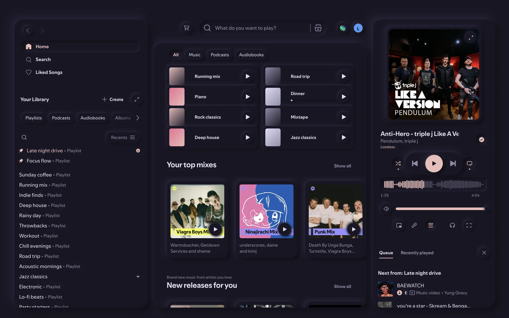
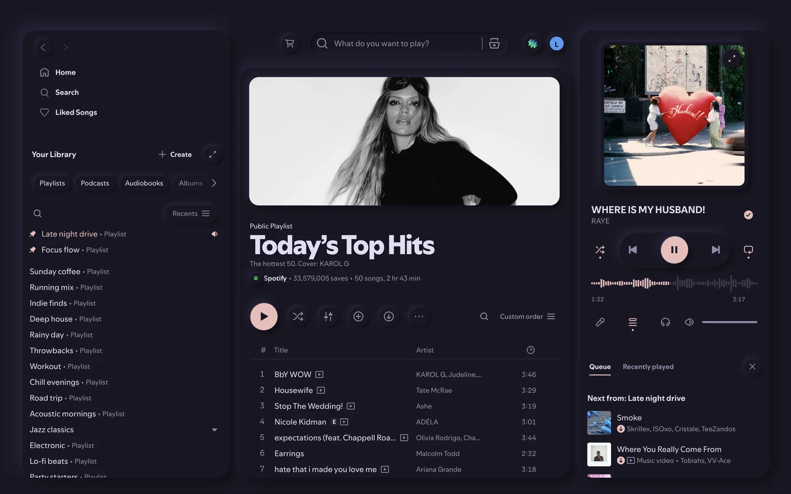
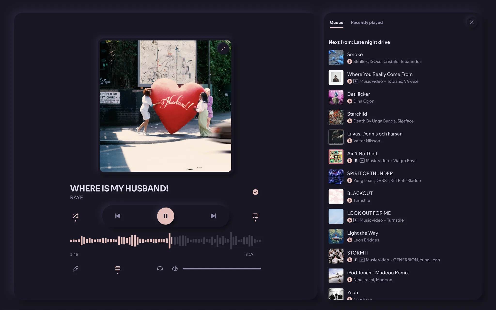
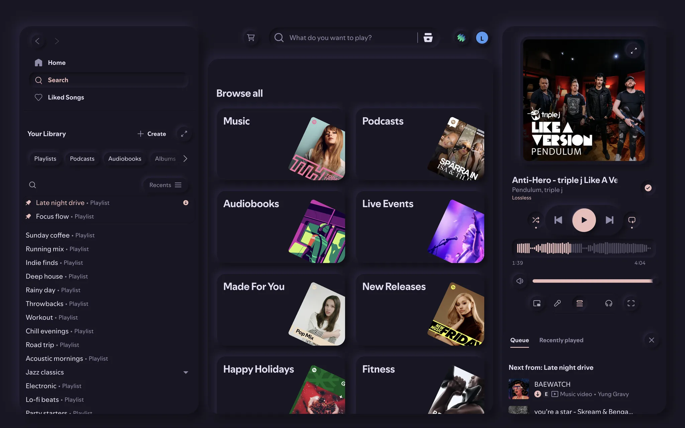
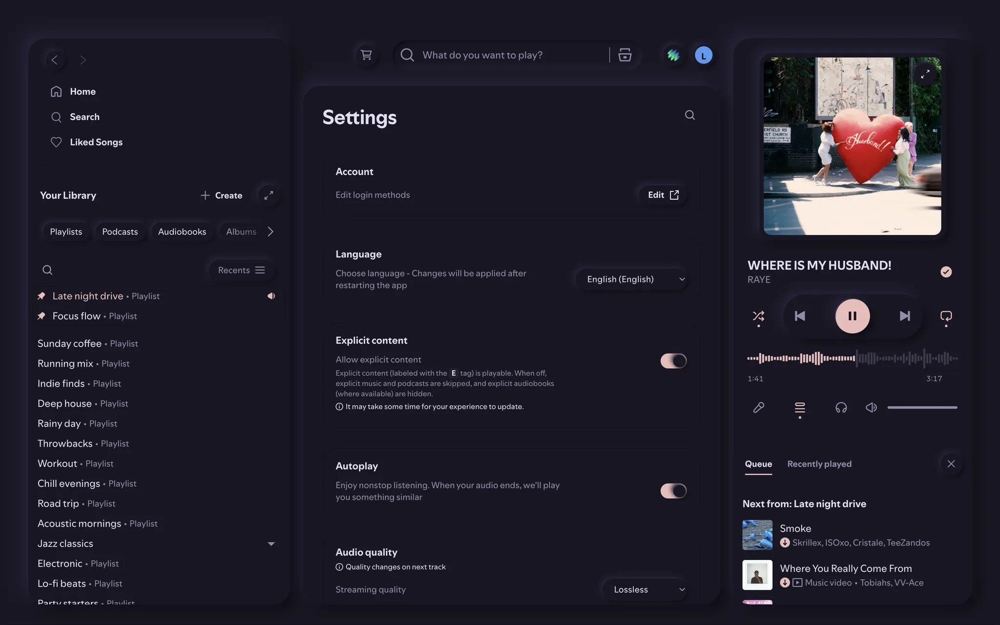
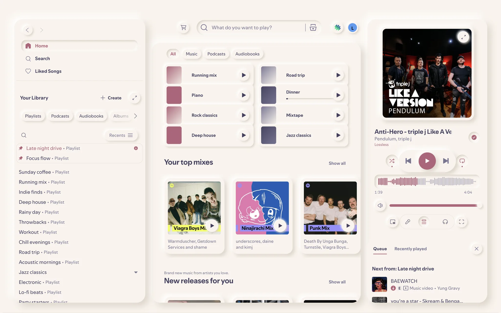
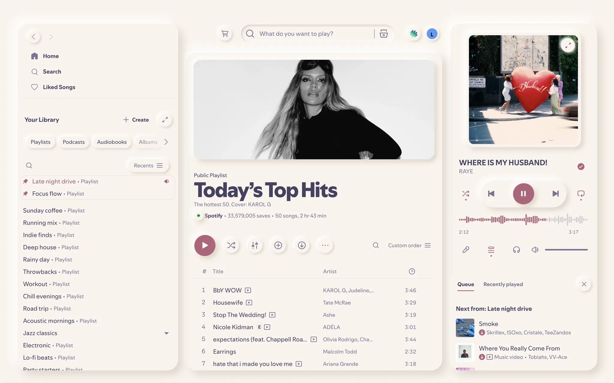
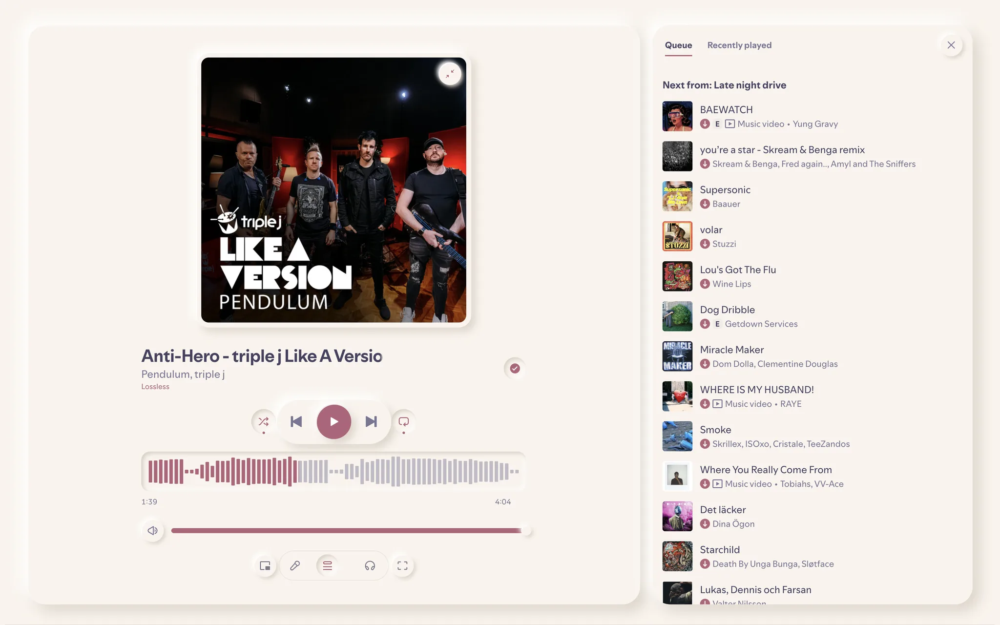
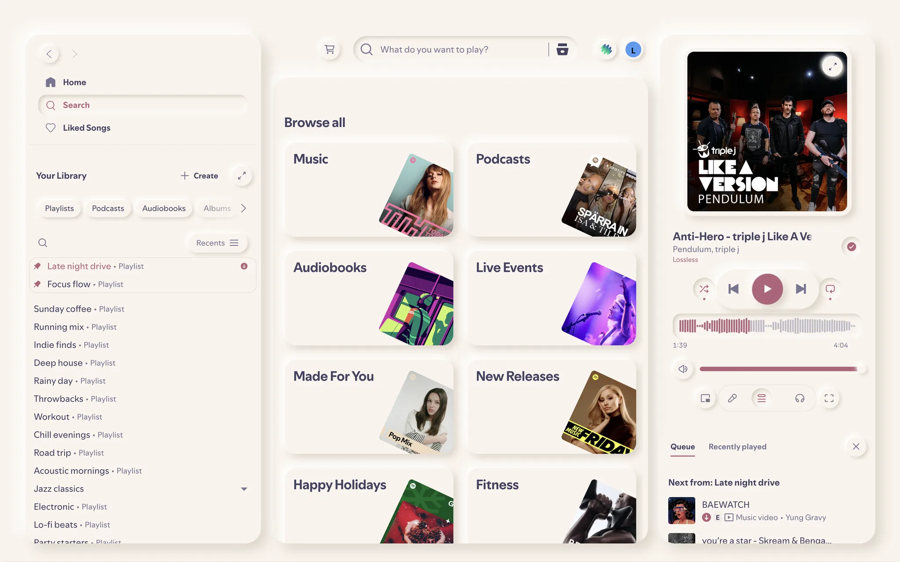
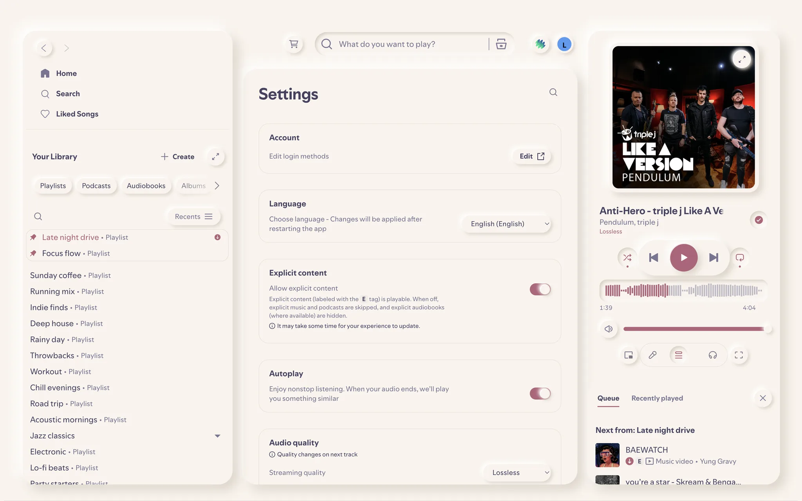

# spotineu

A neumorphic ("soft UI") theme for the Spotify desktop client, built with
[Spicetify](https://spicetify.app). One matte material, light and dark
shadow pairs, raised controls, pressed-in states, and a single accent
colour. Colours are fully themeable through `color.ini`.

spotineu also rethinks Spotify's layout:

- **The stage.** The player and the right panel are one column: large cover,
  controls, progress, then the queue. The track never shows twice, and
  queue, lyrics and devices are tabs right under the player.
- **Navigation where it belongs.** Back, forward, Home, Search and Liked
  Songs sit at the top of the library. Pinned items form their own group.
  The top bar is just search and your account.
- **Waveform seek bar** drawn from the track's loudness.
- **Listening mode** (⌘/Ctrl+Shift+F, or the button on the cover): only the
  large player and the queue or lyrics.
- **Calmer content.** Compact page headers instead of giant banners, the
  playing row shows its own progress, play buttons on cards are always
  visible, and upsells, ads, concert promos and panel filler are gone.

Every feature can be switched off under **profile menu → spotineu**. If a
Spotify update breaks one, that part falls back to the plain neumorphic
look instead of breaking. Below 1100px window width the classic layout
with a bottom player bar returns.

## Screenshots

Rosé Pine:





| Search | Settings |
|---|---|
|  |  |

Rosé Pine Dawn:





| Search | Settings |
|---|---|
|  |  |

## Install

Requires Spicetify with `inject_theme_js = 1` (tested with 2.46.4). The
layout features live in `theme/theme.js`; without it you get the plain
neumorphic look.

```bash
git clone <this repo> spotineu && cd spotineu
scripts/link-theme.sh --activate light   # or: dark
```

`--activate` links `theme/` into Spicetify's Themes folder, switches to
spotineu, applies it, and saves your previous theme in `.previous-theme`.

To go back to your previous theme:

```bash
IFS='|' read -r t s < .previous-theme
spicetify config current_theme "$t" color_scheme "$s" && spicetify apply
```

## Colour schemes

Included schemes: `light`, `dark`, `rose-pine`, `rose-pine-moon` and
`rose-pine-dawn` ([Rosé Pine](https://rosepinetheme.com/en/palette/)).
Switch with `spicetify config color_scheme <name> && spicetify apply`.

Each `[section]` in `theme/color.ini` is a scheme. Besides Spicetify's 18
base keys, every scheme sets `neu-light` and `neu-dark` (the two shadow
colours, which set how strong the depth is) and `on-accent`. Write hex
values without `#`.

## Features and known limits

| Feature (spotineu menu) | What it does | Limits |
|---|---|---|
| Stage layout | Player + right panel in one column; top bar becomes the main column's head | Needs a window at least 1100px wide; the right panel is always open (queue by default) and has a fixed width |
| Left navigation | Back, forward, Home, Search, Liked Songs at the top of the library; pinned group | |
| Declutter | Hides What's new, friend activity, upsells, ads, concert and merch promos, the Jam invite, and now-playing-view filler | Podcasts and audiobooks stay |
| Two-line track rows | Calmer rows, round play button, progress on the playing row, fewer columns in a narrow main column | Compact view stays one line |
| Compact headers and cards | Natural-height headers, contained hero photos, always-visible play buttons, roomier home shortcuts | |
| Waveform seek bar | Loudness bars behind the progress slider | Uses Spotify's internal audio analysis, which Spotify closed for third-party apps in 2024. If it stops answering, the plain slider shows |
| Listening mode | ⌘/Ctrl+Shift+F or the cover button; Esc leaves | |

## Layout of this repo

- `theme/`: the theme (`color.ini`, `user.css`, bundled Figtree font)
- `scripts/`: link, static check, live screenshots, DOM inspection, demo mode
  for anonymised screenshots
- `docs/screenshots/`: the images above
- `.agents/skills/`: guides for coding agents working on the theme:
  `spotineu-design` (the design language), `spicetify-theme` (how to build),
  `spicetify-test` (how to verify)

## Credits

Figtree by Erik Kennedy, SIL Open Font License 1.1
(`theme/assets/fonts/spotineu/OFL.txt`).
