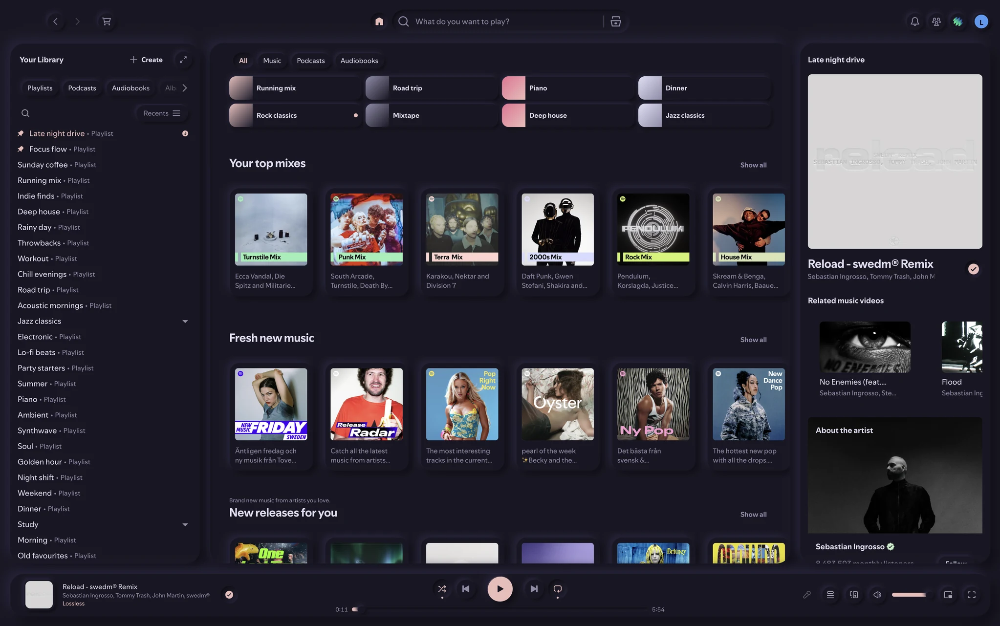
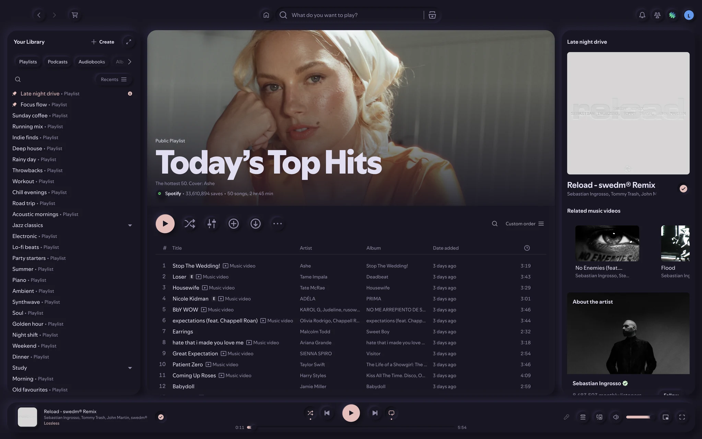
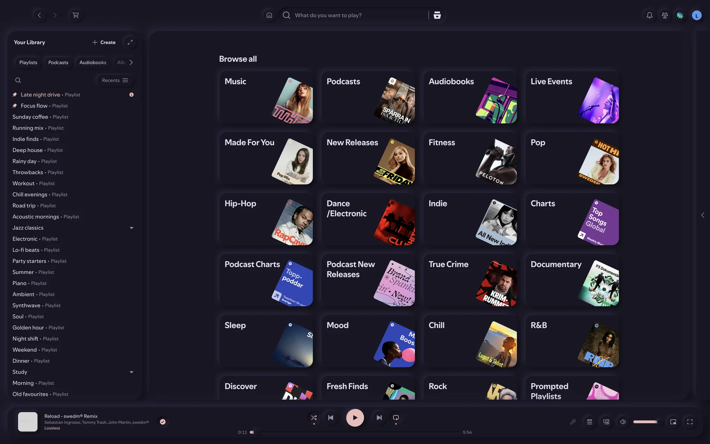
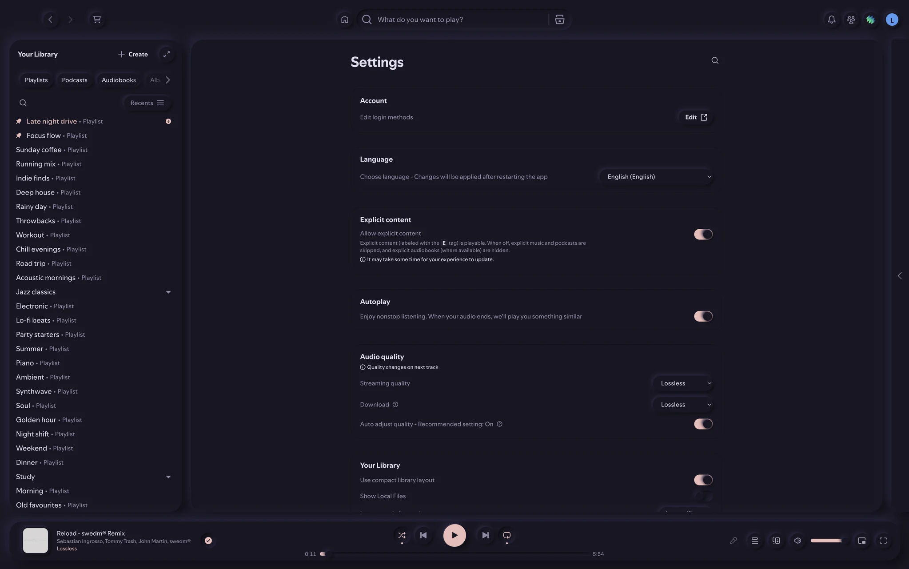
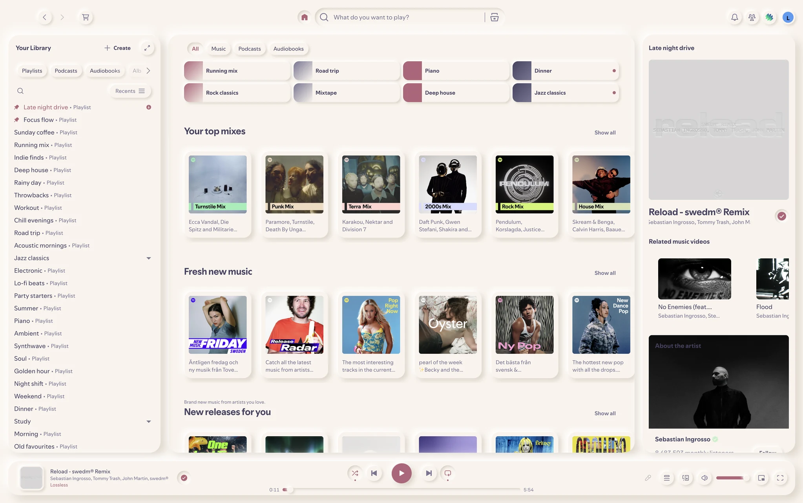
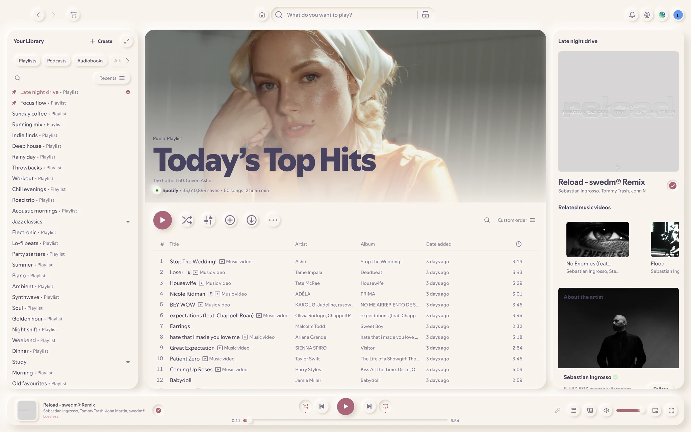
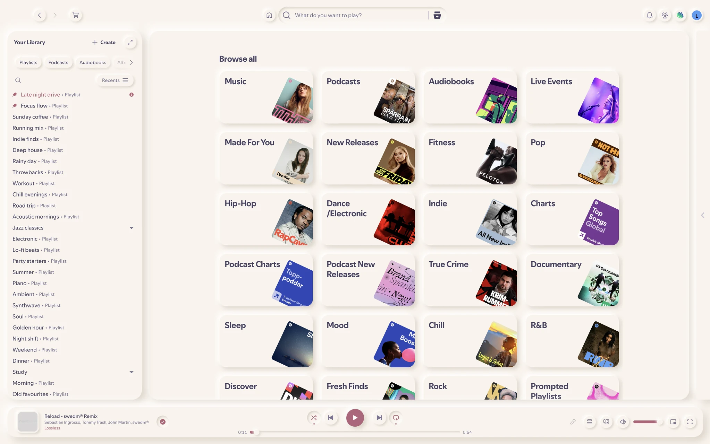
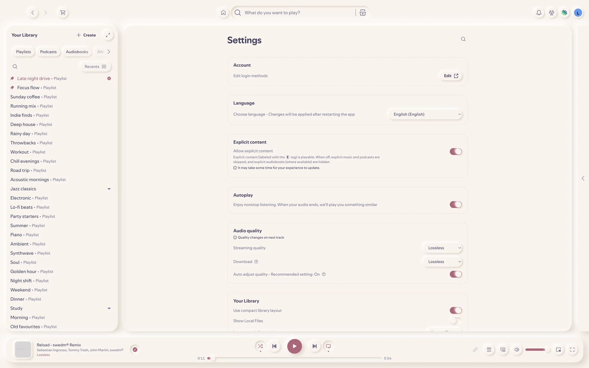

# spotineu

A neumorphic ("soft UI") theme for the Spotify desktop client, built with
[Spicetify](https://spicetify.app). One matte material, light and dark
shadow pairs, raised controls, pressed-in states, and a single accent
colour. Colours are fully themeable through `color.ini`.

## Screenshots

Rosé Pine:




| Search | Settings |
|---|---|
|  |  |

Rosé Pine Dawn:




| Search | Settings |
|---|---|
|  |  |

## Install

Requires Spicetify (tested with 2.45.3 on Spotify 1.3.8).

```bash
git clone <this repo> spotineu && cd spotineu
scripts/link-theme.sh --activate light   # or: dark
```

`--activate` links `theme/` into Spicetify's Themes folder, switches to
spotineu, applies it, and saves your previous theme in `.previous-theme`.

To go back to your previous theme:

```bash
IFS='|' read -r t s < .previous-theme
spicetify config current_theme "$t" color_scheme "$s" && spicetify apply
```

## Colour schemes

Included schemes: `light`, `dark`, `rose-pine`, `rose-pine-moon` and
`rose-pine-dawn` ([Rosé Pine](https://rosepinetheme.com/en/palette/)).
Switch with `spicetify config color_scheme <name> && spicetify apply`.

Each `[section]` in `theme/color.ini` is a scheme. Besides Spicetify's 18
base keys, every scheme sets `neu-light` and `neu-dark` (the two shadow
colours, which set how strong the depth is) and `on-accent`. Write hex
values without `#`.

## Layout of this repo

- `theme/`: the theme (`color.ini`, `user.css`, bundled Figtree font)
- `scripts/`: link, static check, live screenshots, DOM inspection, demo mode
  for anonymised screenshots
- `docs/screenshots/`: the images above
- `.agents/skills/`: guides for coding agents working on the theme:
  `spotineu-design` (the design language), `spicetify-theme` (how to build),
  `spicetify-test` (how to verify)

## Credits

Figtree by Erik Kennedy, SIL Open Font License 1.1
(`theme/assets/fonts/spotineu/OFL.txt`).
